# ClubSphere

ClubSphere is a unified campus student club and event management platform built with FastAPI, SQLAlchemy, PostgreSQL, React 19, TypeScript, and TailwindCSS v4. Azure Database for PostgreSQL Flexible Server is the hosted database target; SQLite remains available for local development and isolated tests. The app streamlines club administration, event registration, proposal workflows, and student engagement across campus.

## Architecture

ClubSphere follows a clean, decoupled architecture separating UI presentation, domain business rules, and API infrastructure:

* **Backend (`backend/`)**: FastAPI application providing secure REST APIs, role-based access control (RBAC), SQLAlchemy ORM models, Pydantic schemas, and Pytest coverage.
* **Database**: PostgreSQL through psycopg 3 and Alembic; local development can use SQLite.
* **Frontend (`frontend/`)**: React 19 single-page application powered by Vite, TailwindCSS v4, React Router, and a domain-driven service architecture with centralized authentication.
* **Runner (`app.py`)**: Unified Python runner that detects port conflicts, verifies dependencies, and concurrently boots both backend and frontend servers with colored logs.
* **Documentation (`docs/`)**: Entity-Relationship documentation including DBML and Mermaid visual schemas.

### Project Architecture Diagram

The diagram below shows the main runtime components and the path a typical request follows. The browser serves the React application; API calls go to FastAPI, which enforces authentication and permissions before reading or writing PostgreSQL data. Uploads use configured object storage (Azure Blob Storage or the secure local fallback).

```mermaid
flowchart LR
    Actors["Students · Club Managers · Faculty · Administrators"] --> Browser["Web browser"]
    subgraph Frontend["Frontend · React 19 + TypeScript + Vite"]
        Landing["Public landing page<br/>Three.js visuals"]
        Pages["Club, event, application,<br/>management and admin pages"]
        Auth["Auth context<br/>in-memory access token"]
        Services["Feature services + API client<br/>credentialed requests"]
        Landing --> Pages
        Pages --> Auth --> Services
    end
    Browser --> Frontend
    Services -->|"HTTPS / REST · /api/v1"| Middleware["FastAPI middleware<br/>CORS · security headers · body limits"]
    subgraph Backend["Backend · FastAPI + Python"]
        Middleware --> Routes["Versioned API routers<br/>auth · clubs · events · proposals<br/>notifications · admin · uploads · academics"]
        Routes --> Rules["Pydantic schemas · validation<br/>RBAC + object authorization"]
        Rules --> ORM["SQLAlchemy ORM + connection pool"]
        Migrations["Alembic schema migrations"] --> ORM
    end
    ORM -->|"psycopg · TLS"| DB[("PostgreSQL<br/>Azure target / configured provider")]
    Routes -->|"poster and document uploads"| Storage["Azure Blob Storage<br/>or secure local storage"]
    Backend -. "health / readiness" .-> Probe["/health · /health/live"]
    Deploy["Docker Compose / Render configuration"] -. "runs frontend + backend" .-> Frontend
    Deploy -.-> Backend
```



### Request flow

1. A user opens the public landing page or signs in; protected routes are gated by the shared authentication context.
2. A page calls a feature service (`frontend/src/services/`), which uses the shared API client to send a request to `/api/v1`.
3. FastAPI middleware applies ingress and security checks, then the relevant router validates inputs and checks roles and resource ownership.
4. The SQLAlchemy models read or write the configured PostgreSQL database. Upload routes store files in the configured blob provider or local fallback.
5. The API returns JSON (and, for session renewal, secure cookies); the frontend updates its page state. Health endpoints support deployment probes.

For the code-level UI tour and safe places to customize the experience, see [docs/UI_GUIDE.md](docs/UI_GUIDE.md). The logo source is [frontend/public/clubsphere-logo.svg](frontend/public/clubsphere-logo.svg).

## Quick Start

### Option 1: Unified Runner (Recommended)

From the project root:

```powershell
python app.py
```

This checks prerequisites, initializes required folders, and launches both services:
* Frontend: `http://localhost:5173`
* Backend API: `http://localhost:8000`
* Interactive API Docs: `http://localhost:8000/docs`

### Option 2: Running Services Individually

#### Backend Setup

```powershell
cd backend
Copy-Item .env.example .env
python -m pip install -r requirements.txt
python -m uvicorn app.main:app --reload --host 127.0.0.1 --port 8000
```

The copied example uses a local SQLite database. For Azure Database for PostgreSQL, provision the server and configure its URL and TLS settings in the backend's environment before starting the API. Follow [instructions.md](instructions.md) for Azure for Students setup, safe Neon data migration, and verification. Keep real connection strings in an ignored `.env` file or deployment secret store; never commit them.

#### Frontend Setup

```powershell
cd frontend
npm install
npm run dev
```

## Role-Based Access Control

ClubSphere uses these application roles:

* **Student**: Browse club profiles, request membership, register for events, and submit club proposals.
* **Club Manager**: Manage assigned clubs, review membership requests, and update the active roster. Managers see the pending-request count for their clubs.
* **Faculty**: Review club proposals and receive notifications about membership requests for clubs in their program and draft event submissions.
* **HOD**: Review proposals at the department approval stage and view administrative review tools.
* **Administrator**: Manage all clubs and platform administration. Administrators see the global pending-request count.

The sidebar shows **Manage club** only to Club Managers and Administrators, and shows **Admin** only to Administrators. Protected pages also apply their own authentication and role checks.

## Key Frontend Features

* **Club directory**: Search and filter clubs by academic program, see membership state on each card, and open a detailed club profile.
* **Club detail page**: View the club description and strategic vision, faculty steward, leadership contacts, events, and recorded achievements. Sections use consistent editorial headings, bordered cards, and responsive grids.
* **Membership workflow**: Students can send one request per club and see whether it is pending or active. Managers can approve or reject requests, change active member roles, or remove members. Successful actions show non-blocking toast feedback.
* **Event board**: Browse published campus events, check dates and remaining seats, and register or cancel a registration.
* **Notifications**: The authenticated notification panel refreshes when opened and stays within the viewport. Managers receive join-request notices; program faculty also receive those requests and notifications for draft event submissions. Users can mark one or all notices as read.
* **Editorial interface**: Warm newsprint colors, serif headlines, fine ink rules, responsive page layouts, and the ClubSphere logo carry through the public pages and signed-in workspace. The landing page’s Three.js globe remains independently rendered.

See [docs/UI_GUIDE.md](docs/UI_GUIDE.md) for a page-by-page UI overview and source-file map.

## Verification & Testing

### Backend Test Suite

Run unit and integration tests covering authentication, clubs, events, registrations, proposals, and RBAC security:

```powershell
cd backend
pytest
```

### Frontend Code Quality

Run Oxlint and production TypeScript compilation:

```powershell
cd frontend
npm run lint
npm run build
```

## Database Schema & Documentation

For comprehensive schema diagrams, foreign key relationships, and design notes, consult:
* `docs/DATABASE_ER_SCHEMA.md`
* `docs/schema.mermaid`
* `docs/schema.dbml`
* `docs/system-design.md` for the current Azure PostgreSQL architecture
