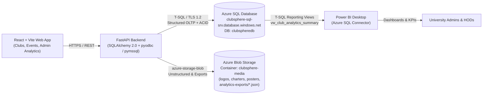

# ClubSphere — DP-900 Data Classification, Cloud Architecture & Power BI Setup Guide

**Course / Exam Alignment:** Microsoft Azure Data Fundamentals (**DP-900**)  
**Platform:** ClubSphere — University Club & Activity Lifecycle Management System  
**Target Azure SQL Server:** `clubsphere-sql-srv.database.windows.net` (Database: `clubspheredb`, Admin User: `clubsphereadmin`)  
**Non-Relational Storage:** Azure Blob Storage (`clubsphere-media` container)  
**BI & Analytics Layer:** Power BI Desktop via `vw_club_analytics_summary` and `GET /api/v1/analytics/overview`

---

## 1. End-to-End Azure Cloud Data Architecture

ClubSphere implements a multi-model Azure data tier combining structured relational persistence, semi-structured JSON payloads, unstructured object storage, and an analytical T-SQL reporting layer:



---

## 2. DP-900 Data Classification Matrix

### 2.1 Structured Data (Azure SQL Database — T-SQL in `clubspheredb`)
Strongly typed relational tables in Third Normal Form (3NF) using T-SQL data types (`INT IDENTITY(1,1)`, `NVARCHAR(n)`, `NVARCHAR(MAX)`, `DATETIME2`, `BIT`), primary/foreign keys, unique indexes, and `CHECK` constraints:

| Table | Entity Role | Key T-SQL Columns & Constraints |
|---|---|---|
| `Branches`, `Programs` | Institutional academic hierarchy | `BranchId INT IDENTITY(1,1) PK`, `ProgramKey NVARCHAR(100) UNIQUE`, FK `BranchId` |
| `Roles`, `Users` | RBAC directory & Argon2id auth accounts | `Email NVARCHAR(256) UNIQUE`, `IsActive BIT`, `CreatedAt DATETIME2 DEFAULT SYSUTCDATETIME()` |
| `Clubs` | Chartered student organizations (`clubs`) | `Status NVARCHAR(20)` (`pending`, `active`, `suspended`), `LogoUrl NVARCHAR(500)`, `CharterPdfUrl NVARCHAR(500)` |
| `ClubMemberships` | Student club requests, active rosters & leads (`club_memberships`) | `UNIQUE (ClubId, UserId)`, `Status IN ('requested','active','removed')`, `Role NVARCHAR(30)` |
| `Events` | Scheduled events & seat capacities (`events`) | `CK_Events_Capacity CHECK (Capacity > 0)`, `CK_Deadline_Before_Event`, `PosterUrl NVARCHAR(500)` |
| `EventRegistrations` | Confirmed/waitlisted/cancelled bookings | `UNIQUE (EventId, UserId)`, `IX_Reg_EventId_Status` |
| `Attendance`, `EventOutcomes` | Verified check-ins & post-event summaries | `UNIQUE (EventId, UserId)`, `AttendanceCountSnapshot INT` |
| `ClubProposals`, `Approvals` | Multi-stage Faculty -> HOD approval workflow | `CK_Approvals_Stage CHECK (Stage IN ('faculty','hod'))` |
| `Notifications`, `AuditLogs` | Alerts and immutable governance log | `IX_Notif_UserId_IsRead`, `IX_Audit_Entity` |
| `UploadedFiles` | Relational index linking records to Blob URLs | `FileId NVARCHAR(64) PK`, `BlobPath NVARCHAR(500)`, `MimeType`, `FileSizeBytes` |
| `RefreshSessions`, `AuthThrottle` | JWT session rotation & brute-force rate limits | `TokenHash NVARCHAR(64) UNIQUE`, `UQ_AuthThrottle_Scope_Key` |

### 2.2 Semi-Structured Data (JSON Documents & Telemetry Exports)
- **Inline Semi-Structured JSON in Azure SQL (`NVARCHAR(MAX)`):**
  - `Clubs.PastAchievements`: Schema-flexible JSON arrays capturing club awards/laurels (`title`, `date`, `award_or_highlight`, `description`).
  - `Clubs.LeadershipContacts`: Embedded JSON officer directory (`role`, `name`, `email`, `phone`).
  - `AuditLogs.Details`: JSON payload tracking state mutations across proposals, memberships, and role updates.
- **Static Catalog Seeds (`backend/app/data/*.json`):**
  - `branches.json` & `programs.json` consumed by `seed_academic_data()`.
- **Analytics Export Blobs (`analytics-exports/*.json`):**
  - `POST /api/v1/analytics/export` serializes point-in-time institutional snapshots (`overview`, `branch_metrics`, `club_summaries` from `vw_club_analytics_summary`) into `clubsphere-media/analytics-exports/` inside Azure Blob Storage.

### 2.3 Unstructured Data (Azure Blob Storage — `clubsphere-media`)
Binary media and institutional documents validated via magic-byte inspection (`backend/app/services/storage.py`) and uploaded via dedicated REST endpoints:
- **Club Crest Logos (`clubs/{club_id}/logos/`):** PNG, JPEG, WebP uploaded via `POST /api/v1/clubs/{club_id}/media` and rendered on Club cards (`/clubs`, `/joinclub`) and `ClubDetailsPage.tsx`.
- **Official Charter Documents (`clubs/{club_id}/charters/`):** Charter PDFs uploaded via `POST /api/v1/clubs/{club_id}/media` and linked on `ClubDetailsPage.tsx`.
- **Event Posters (`events/{event_id}/posters/`):** Event promotional banners uploaded via `POST /api/v1/events/{event_id}/banner` and rendered on `/events` Event cards.
- **Proposal Attachments (`proposals/{proposal_id}/`):** Supporting PDF/DOCX proposals uploaded via `POST /api/v1/uploads` and gated behind authorized API downloads.

---

## 3. Target Azure Configuration & Neon Migration Steps

### Step 3.1 Azure SQL Connection Parameters (`clubspheredb`)
- **Server:** `clubsphere-sql-srv.database.windows.net`
- **Port:** `1433`
- **Database:** `clubspheredb`
- **Admin Login:** `clubsphereadmin`
- **ODBC Connection URL Format (Render / Docker):**
  ```text
  mssql+pyodbc://clubsphereadmin:<URL_ENCODED_PASSWORD>@clubsphere-sql-srv.database.windows.net:1433/clubspheredb?driver=ODBC+Driver+18+for+SQL+Server&Encrypt=yes&TrustServerCertificate=no
  ```
- **Pure-TDS Driver Alternative (`pymssql`):**
  ```text
  mssql+pymssql://clubsphereadmin:<URL_ENCODED_PASSWORD>@clubsphere-sql-srv.database.windows.net:1433/clubspheredb
  ```
- **Security Note:** Never commit plaintext credentials or passwords into `.env`, `render.yaml`, or Git history. Store credentials exclusively in Render Dashboard environment secrets (with special characters URL-encoded, e.g., `@` -> `%40`).

### Step 3.2 Azure SQL Firewall Rules for Render & Power BI Desktop
In the Azure Portal -> **`clubsphere-sql-srv`** -> **Security -> Networking -> Firewall rules**:
1. Enable **Allow Azure services and resources to access this server** (`Yes`).
2. Add your local workstation's public IP address so `migrate_neon_to_azure_sql.py`, `alembic upgrade head`, and **Power BI Desktop** can connect cleanly.
3. Add the Render outbound static IP addresses from Render Dashboard -> `clubsphere-backend` -> **Outbound IP Addresses**.

### Step 3.3 Azure Blob Storage Setup (`clubsphere-media`)
1. In Azure Portal -> Storage Account -> **Data storage -> Containers -> + Container**, create **`clubsphere-media`**.
2. Open **Security + networking -> Access keys**, copy **Connection string (`key1`)**.
3. Set in Render Dashboard (without committing to Git):
   - `AZURE_STORAGE_CONNECTION_STRING`: *(your Azure Storage connection string)*
   - `AZURE_STORAGE_CONTAINER_NAME`: `clubsphere-media`
   - `AZURE_STORAGE_USE_EMULATOR`: `false`

### Step 3.4 Run Idempotent Neon -> Azure SQL Migration
Run from `backend/`:
```bash
cd backend
python scripts/migrate_neon_to_azure_sql.py \
  --source-url "postgresql://neondb_owner:<NEON_PW>@ep-xxx.neon.tech/neondb?sslmode=require" \
  --target-url "mssql+pyodbc://clubsphereadmin:<URL_ENCODED_PASSWORD>@clubsphere-sql-srv.database.windows.net:1433/clubspheredb?driver=ODBC+Driver+18+for+SQL+Server&Encrypt=yes&TrustServerCertificate=no"
```
This initializes schema tables in dependency order, preserves all primary keys via `SET IDENTITY_INSERT <table> ON`, creates `vw_club_analytics_summary`, stamps Alembic `head`, and prints a full row-count parity verification report.

---

## 4. Connecting Power BI Desktop & Generating DP-900 Reports

1. Open **Power BI Desktop**.
2. Click **Get Data** -> **Azure** -> **Azure SQL Database** -> **Connect**.
3. Enter:
   - **Server:** `clubsphere-sql-srv.database.windows.net`
   - **Database:** `clubspheredb`
   - **Data Connectivity mode:** **Import** (or **DirectQuery** for live T-SQL queries).
4. Choose **Database** authentication, enter **`clubsphereadmin`** and password, then click **Connect**.
5. Select the reporting views from Navigator and click **Load**:
   - **`vw_club_analytics_summary`** — Aggregates clubs, `ActiveMembersCount`, `PendingMembersCount`, `RemovedMembersCount`, `LeadershipCount`, `TotalEventsCount`, `PublishedEventsCount`, `CompletedEventsCount`, `ConfirmedRegistrationsCount`, and `TotalAttendanceCount`.
   - `vw_EventRegistrationSummary` — Seat capacity and fill rate percentages.
   - `vw_AttendanceRate` — Confirmed vs. checked-in attendance turnout rates.
   - `vw_BranchParticipation` — Monthly branch-level participation trends.
6. Build visuals (KPI cards for active clubs/members/leaders/attendance, clustered bar chart comparing Active vs. Pending members per club, Branch donut chart) and export via **File -> Export -> Export to PDF**.
