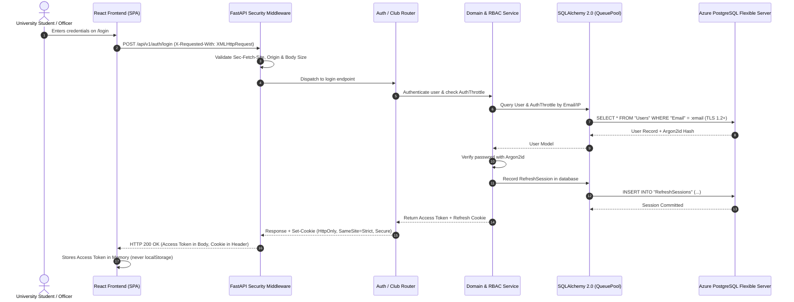
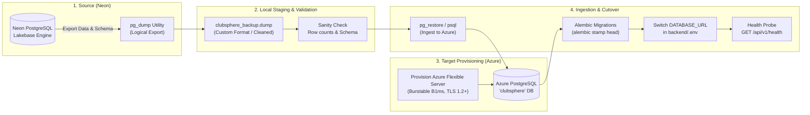

# ClubSphere System Architecture & Database Design

## 1. System Architecture Overview

ClubSphere is a full-stack university club and activity lifecycle management platform engineered with a decoupled frontend single-page application (React 19 + Vite), a high-performance RESTful API backend (FastAPI + Python), and an enterprise-grade relational database powered by **Microsoft Azure Database for PostgreSQL Flexible Server**.

```mermaid
flowchart TD
    subgraph Clients["University Actors & Client Tier"]
        U1["Student User"]
        U2["Club Manager"]
        U3["Faculty / HOD"]
        U4["Administrator"]
    end

    subgraph Frontend["Frontend Client (React 19 + Vite + TailwindCSS)"]
        UI["React SPA (Client-side Routing)"]
        AUTH_CTX["Auth Context (In-Memory Access Token)"]
        API_CLIENT["Axios Interceptor (withCredentials: true)"]
        UI --> AUTH_CTX
        AUTH_CTX --> API_CLIENT
    end

    U1 -->|HTTPS| UI
    U2 -->|HTTPS| UI
    U3 -->|HTTPS| UI
    U4 -->|HTTPS| UI

    subgraph Backend["FastAPI Backend Application Service"]
        subgraph Middleware["Security & Ingress Middleware"]
            HTTPS_MW["HTTPS Redirect Middleware"]
            SEC_HDRS["Security Headers Middleware (HSTS, CSP, X-Frame)"]
            CORS_MW["CORS Middleware (Explicit Origins Only)"]
            BODY_LIMIT["Body Size Limit Middleware (2 MB)"]
            CSRF_GUARD["CSRF Guard (Sec-Fetch-Site & Custom Headers)"]
            LOG_FILTER["SensitiveDataFilter (Redacts Passwords, URLs & Tokens)"]
        end

        subgraph APIRoutes["API V1 Endpoints"]
            R_AUTH["/api/v1/auth (Argon2id + Rotating Cookies)"]
            R_CLUBS["/api/v1/clubs (Directory, Join & Management)"]
            R_EVENTS["/api/v1/events (Scheduling & Registration)"]
            R_PROPOSALS["/api/v1/proposals (Club Activity Approvals)"]
            R_ADMIN["/api/v1/admin (User Roles & Audit Invalidation)"]
            R_HEALTH["/health & /api/v1/health (Readiness Probes)"]
        end

        subgraph CoreServices["Domain Security & Business Logic"]
            ARGON2["Argon2id Password Hasher (m=64MB, t=3, p=4)"]
            RBAC["Role-Based Access Control (RBAC Matrix)"]
            OBJ_AUTH["Object-Level Authorization (IDOR Protection)"]
            THROTTLE["Database-Backed Rate Limiting (AuthThrottle)"]
            JWT_MGR["JWT Token Manager (Access 15m, Refresh 7d)"]
        end

        subgraph DataAccess["Data Access & ORM Layer"]
            ORM["SQLAlchemy 2.0 ORM Declarative Models"]
            POOL["QueuePool (pre_ping=True, recycle=300s, size=10, burst=20)"]
            ALEMBIC["Alembic Migration Engine (backend/alembic)"]
            DRIVER["psycopg (v3) PostgreSQL Adapter"]
        end
    end

    API_CLIENT -->|HTTPS / REST API / TLS 1.3| HTTPS_MW
    HTTPS_MW --> SEC_HDRS --> CORS_MW --> BODY_LIMIT --> CSRF_GUARD --> APIRoutes
    APIRoutes --> CoreServices
    CoreServices --> DataAccess
    DataAccess --> ORM --> POOL --> DRIVER

    subgraph AzureCloud["Microsoft Azure Cloud Services"]
        subgraph AzurePostgres["Azure Database for PostgreSQL Flexible Server"]
            PG_ENGINE["PostgreSQL 16 Engine"]
            PG_STORAGE["Managed SSD Storage (32 GiB, Burstable B1ms)"]
            PG_FIREWALL["Server Firewall (Restricted IP / VNet Access)"]
            PG_TLS["Enforced TLS 1.2+ (DigiCert Global Root G2)"]
            PG_FIREWALL --> PG_TLS --> PG_ENGINE --> PG_STORAGE
        end

        subgraph AzureStorage["Azure Storage Services"]
            BLOB["Azure Blob Storage (clubsphere-uploads)"]
        end

        subgraph Secrets["Environment Configuration"]
            ENV[".env / Environment Variables (DATABASE_URL, JWT_SECRET)"]
        end
    end

    DRIVER -->|Encrypted TLS (Port 5432)| PG_FIREWALL
    APIRoutes -->|Uploads / Multipart| BLOB
    ENV -.->|Injected at Startup| Backend
```

---

## 2. Component Responsibilities

| Layer / Component | File / Path | Key Responsibility |
|---|---|---|
| **Frontend SPA** | `frontend/src/` | Client-side UI built with React 19, Vite, and TailwindCSS. Manages ephemeral access tokens in memory, renders role-gated dashboards, and interacts with backend APIs using credentialed cookies. |
| **Ingress Middleware** | `backend/app/core/middleware.py` | Enforces HTTPS redirection, applies standard security headers (HSTS, CSP, X-Frame-Options: DENY, X-Content-Type-Options: nosniff), validates body sizes, and enforces anti-CSRF policies on state-changing endpoints. |
| **Authentication & Sessions** | `backend/app/api/v1/auth.py`, `backend/app/core/security.py` | Issues short-lived access tokens (15-min TTL) and rotating `HttpOnly`, `SameSite=Strict`, `Secure` refresh cookies (7-day TTL). Implements Argon2id password hashing and session revocation. |
| **Authorization & RBAC** | `backend/app/core/rbac.py`, `backend/app/core/authorization.py` | Enforces two-tier authorization: declarative role-based routing (`RoleChecker`) and programmatic object-level ownership / academic branch checks. |
| **Rate Limiter & Brute-Force Guard** | `backend/app/core/rate_limit.py` | Persistent, database-backed rate limiting via the `AuthThrottle` model. Uses dual keys (IP address + normalized username) to prevent brute-force attacks across distributed deployments. |
| **Data Access & ORM** | `backend/app/core/database.py`, `backend/app/models/models.py` | Synchronous SQLAlchemy 2.0 ORM with connection pooling (`pool_pre_ping=True`, `pool_recycle=300s`, `pool_size=10`). |
| **Azure Database for PostgreSQL Flexible Server** | Cloud Infrastructure | Fully managed cloud PostgreSQL service with automated backups, built-in high availability, Burstable B1ms compute, and enforced TLS 1.2+ encryption in transit. |
| **Object Storage** | `backend/app/core/storage.py` | Stores user-uploaded event posters and proposal documentation either via Azure Blob Storage or local secure storage fallback. |

---

## 3. Request & Data Lifecycle



---

## 4. Neon to Azure Database Migration Workflow

The migration from Neon PostgreSQL to Microsoft Azure Database for PostgreSQL Flexible Server follows a zero-loss, schema-verified pipeline:



### Migration Verification Milestones
1. **Source Backup Preservation:** The existing Neon database remains completely untouched and active as a cold fallback.
2. **Binary Consistency:** Data exported via `pg_dump -Fc` preserves exact data types, sequence offsets, foreign keys, and quoted PostgreSQL check constraints.
3. **Alembic Synchronization:** Following data restoration on Azure PostgreSQL, Alembic confirms the schema revision match (`c4e9a1b2d3f4_auth_sessions_and_throttle`).
4. **Application Cutover:** `DATABASE_URL` is switched in `backend/.env` to the Azure PostgreSQL connection string (`postgresql+psycopg://...`).
5. **Connectivity & Smoke Verification:** Backend passes health checks with HTTP 200 and all unit/integration tests pass against the target database structure.
